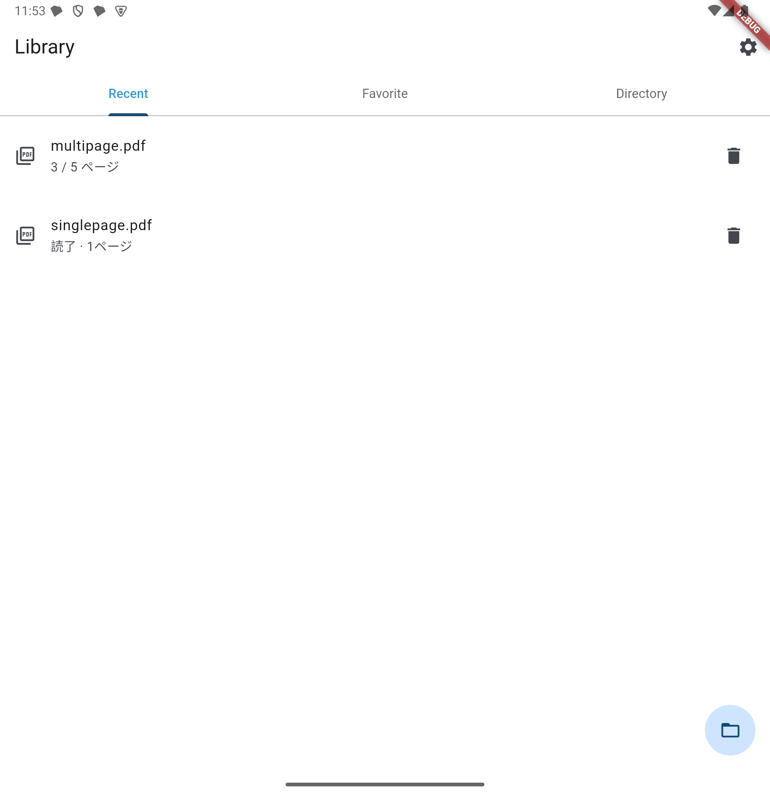
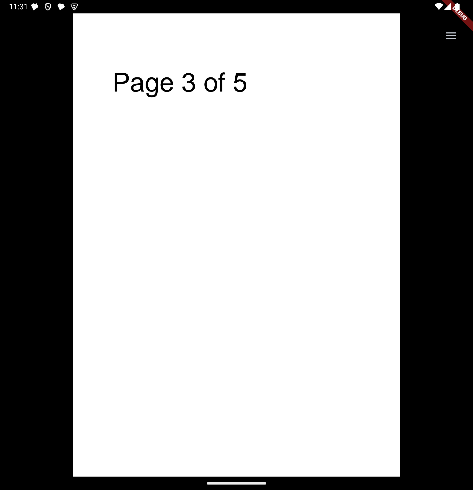
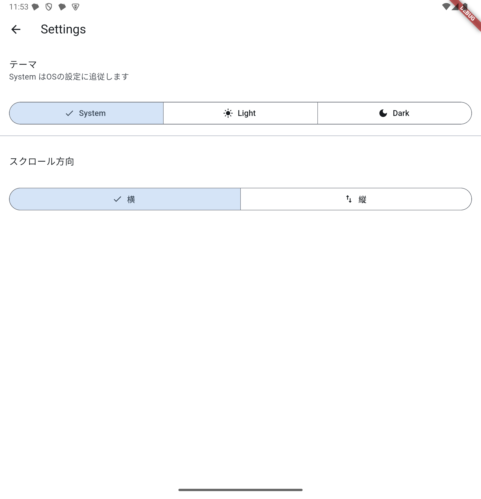

# Flexta PDF Reader

読みかけの位置を覚えてくれる、シンプルな PDF リーダー。

  

## できること

- **ライブラリ** — 開いた PDF をアプリ内に取り込み、Recent / Favorite で一覧する
- **読書位置の記憶** — どのページまで読んだかを自動で保存し、次に開くとそこから再開する
- **重複しない** — 同じ PDF を選び直しても 1 件にまとまり、読書位置が引き継がれる
- **フォルダ登録** — よく使うフォルダを登録して、その中の PDF を一覧から開く
- **表示設定** — 横 / 縦スクロールの切り替え、System / Light / Dark テーマ

## 対応プラットフォーム

| プラットフォーム | 状態 |
|---|---|
| Android | 動作確認済み（Android 15 / API 35） |
| iOS | ビルド・起動確認済み（シミュレータ）。CocoaPods が必要（`brew install cocoapods`） |
| macOS | ビルド確認済み。CocoaPods が必要 |
| Windows / Linux / Web | 未確認 |

`pdfx` と `device_info_plus` は Swift Package Manager 未対応のため、iOS / macOS は当面 CocoaPods が必要。

## 開発環境

Flutter 3.44 系（Dart 3.12）。Android のビルドには JDK 17 以降が要る。

```bash
flutter pub get
flutter analyze          # 警告 0 件を維持する
flutter test
flutter run -d <device>
```

### リリースビルド

`android/key.properties` に署名情報を置くと release 署名が使われる。

```properties
storeFile=/path/to/keystore.jks
storePassword=...
keyAlias=...
keyPassword=...
```

このファイルが無い場合は debug 鍵で署名されるため、署名情報なしでも
`flutter run --release` は動く。

## ディレクトリ構成

```
lib/
├── main.dart                     アプリのエントリと配色テーマ
├── models/
│   └── library_document.dart     ライブラリ1件分のデータ
├── screens/
│   ├── library.dart              ホーム（Recent / Favorite / Directory）
│   ├── viewer.dart               PDF ビューア
│   └── settings.dart             設定
├── store/
│   ├── library_store.dart        取り込み・読書位置・お気に入り・削除
│   └── settings_store.dart       テーマとスクロール方向
└── components/
    └── confirm_dialog.dart       確認ダイアログ
```

状態管理は Riverpod。永続化はライブラリが sqflite、設定が SharedPreferences。

### ファイルの扱いについて

Android のファイル選択（SAF）が返すのは元ファイルではなく、キャッシュ配下の
一時パスで、同じファイルを選び直すたびに変わる。そのためこのアプリは選択された
PDF をアプリ内ストレージへ取り込み、**内容から導出したハッシュを永続 ID** として
扱う。設計の詳細は [CLAUDE.md](CLAUDE.md) に書いてある。

## ライセンス

未設定。
